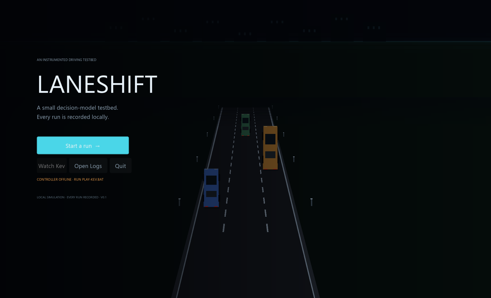
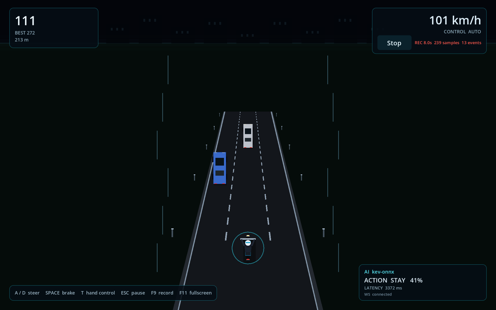

# LANESHIFT

A telemetry-first 2D driving simulator for experimenting with small AI decision models.

LANESHIFT is an early-stage research prototype. It provides a small driving environment in which a human or an external controller can play, while the simulator records state and outcomes directly.

The project is intended to support experiments in fine-tuning compact decision models. The game exports structured telemetry, records discrete events, and exposes a programmatic control interface so the same scenarios can be tested across different controllers.

## Current status

What works today:

- A playable Godot driving simulator with human keyboard controls, a title screen, HUD, pause, game over and restart.
- A coherent pseudo-perspective road with depth fog, lane geometry, traffic sprites, crash feedback, a typographic corner HUD, and a left-aligned title composition over the live road. The earlier full-width toolbar, bordered HUD cards and lane markings through cars are gone.
- Simulation-state export and periodic telemetry at roughly 30 Hz of simulation time. Recording works after a run has already started; the integration test covers that path.
- Event-based action and episode logs.
- A Python controller communicating with the game over a localhost WebSocket.
- Dummy and rule-based policies, both usable as baselines.
- Local ONNX Kev-0.8B inference on ARM64, about 1.4 s per decision at 256 tokens, with a model hash recorded in the provenance metadata.
- A one-click `PLAY-KEV.bat` that starts the local Kev controller and the game together so you can watch the model drive.
- Dataset conversion and experiment tooling, including a Kev-format training export.
- A matched-policy experiment runner. The committed pilot is small; it is a sanity check, not a finished study.

What has **not** been established:

- Fine-tuning has not been performed.
- The model has not been shown to improve gameplay over the rule-based baseline. In the pilot it does not.
- Calibration has not been measured on real held-out human play.

The original design conversation proposed a phone/ADB/MediaProjection capture pipeline and a computer-vision perception layer. That pipeline is not implemented. This repository is the simulation testbed: the engine supplies ground-truth state, so the remaining research question is decision quality and fine-tuning, not perception. The game itself is a focused 2D prototype, not a production game.

## Screenshots





The AI panel shows the model alias, chosen action, probability and inference
latency. The cyan ring marks the externally controlled bike.

## Running the game

Requires Godot 4.7.2 Stable.

```powershell
godot --path .
```

On Windows, `run_game.bat` does the same thing and checks that Godot is on `PATH`.

Controls:

| Key | Action |
| --- | --- |
| `A` / Left Arrow | Move one lane left |
| `D` / Right Arrow | Move one lane right |
| `Space` / Down Arrow | Brake (hold) |
| `T` | Switch between human and connected controller |
| `Escape` | Pause or resume |

Lane changes ease over about a third of a second and are applied once per press. Braking slows the bike, which changes how quickly traffic is caught. A collision ends the run.

The game opens fullscreen. `F11` toggles fullscreen/windowed. `--windowed` starts maximized instead.

## Watch local Kev play

The local path uses the exported ONNX graph, so no Kev server, PyTorch download, or cloud API is involved.

```powershell
PLAY-KEV.bat
```

The launcher finds the default model at `C:\Users\Dhane\dev\kev-onnx-backup\kev07b_fp16_L256.onnx` and the Qwen tokenizer in the Hugging Face cache. Override either with `-Model` and `-Tokenizer`, or with `LANESHIFT_ONNX_MODEL` and `LANESHIFT_ONNX_TOKENIZER`.

```powershell
PLAY-KEV.bat -Windowed
PLAY-KEV.bat -Episodes 10 -EpisodeDuration 20
```

The controller starts on port `8766`, waits for the model to load, then launches the game in auto-run with Kev in control. The bottom-right instrument shows the model alias, the chosen action, the probability and the inference latency. The player has a cyan ring while the external controller has control. Close the game window to stop both processes.

The packaged build contains the game, controller and Python runtime. The model lives on the normal `C:` disk:

```text
C:\LANESHIFT2D-Kev-model\kev07b_fp16_L256.onnx
C:\LANESHIFT2D-Kev-model\kev07b_fp16.data
C:\LANESHIFT2D-Kev-model\tokenizer.json
```

That gives ONNX Runtime a normal NTFS path. On an idle machine it runs about 1.4–2.0 s per decision. Close any other running game before launching; a second render loop can starve the model and push inference past 8 s.

`PLAY-KEV.bat` also enables a watch-mode safety layer. While the model is thinking, the controller sends a fresh rule-based lane or brake action if a collision is imminent. If the model returns an uncertain `STAY` (max probability below 0.55), the rule policy can veto it. These actions are labelled `controller_fallback` and the AI panel shows `FALLBACK`; the model probabilities remain visible. The matched experiment runner never enables this layer, so the research comparison stays pure.

With the model on `C:` and the safety layer enabled, a 15-second seed sweep produced 8 decisions per episode and 7 of 8 episodes survived the full 15 seconds. The one failure was a crash at 4.5 s on seed 8. Pure Kev still chose `STAY` in every decision; the lane changes came from the safety layer.

The released checkpoint's confidence is low: in the 60-second run its probabilities were roughly `STAY 0.38–0.41`, `LEFT 0.17–0.24`, `RIGHT 0.19–0.22`, `BRAKE 0.16–0.24`. `STAY` was the argmax every time. The model is choosing the least-bad option from a nearly uniform distribution, not a confident driving decision.

The controller log is written to `logs\kev-controller.log`.

## Recording human gameplay

Click **Record** in the top bar, or press `F9`, to start a recording session. The
button changes to **Stop**, and the bar shows `REC` with elapsed time, sample count,
and event count. Recording stays active across crashes and restarts until you stop it.
Every session writes `manifest.json`, `telemetry.jsonl`, `events.jsonl`, and
`episodes.jsonl` under `<portable root>/recordings/`.

The session manifest records the session ID, UTC start and end times, build commit,
engine version, recording schema version, status, and record counts. Human actions are
labelled `human`; they are never relabelled as model actions.

## Running the Python controller

The controller is a separate process. Start it first, then launch the game, start a run, and press `T` to hand control over.

```powershell
# dummy: scripted lane changes, used to verify the bridge
python python/server.py --policy dummy

# rule-based: traffic avoidance baseline
python python/server.py --policy rule_based
```

The controller binds to `127.0.0.1:8766` only. Godot connects to it, streams state snapshots, and applies the actions that come back. If the controller is not running, the game stays fully playable with the keyboard. If the controller disconnects or stops sending actions, the game reverts to keyboard control after 1.5 seconds.

## Running a Kev model

For the quick local path, use `PLAY-KEV.bat` above. This section describes the full Kev System One HTTP server path.

The controller speaks to a Kev System One server over HTTP; Godot never sees Kev. The server is a separate process, so the two ports stay independent: WebSocket `8766` for game control, HTTP `8009` for inference.

Start Kev itself, following the upstream project:

```powershell
git clone https://github.com/jaredpalmer/kev.git
cd kev
uv sync --extra serve --python 3.13
uv run --extra serve python -m kev.serve --run jaredpalmer/kev-0.8b@v1.0 --port 8009 --device cpu
```

On Windows, Hugging Face needs `HF_HUB_DISABLE_SYMLINKS=1` because creating symlinks in the cache needs privileges that a normal user does not have.

Then register the checkpoint and start the controller:

```powershell
python python/server.py --policy kev_original --kev-config kev_models.example.json --port 8766
```

`expected_run` must match the `run` value that `GET /v1/models` reports for the checkpoint that is actually loaded. The controller refuses to label a run as a model if it does not, so a swapped or missing checkpoint fails at startup instead of producing fake model data. `kev_models.example.json` is a template; copy it and adjust the values for your own setup. Never commit API keys; the controller reads `KEV_API_KEY` from the environment.

### Status of model integration

| State | Status |
| --- | --- |
| Local ONNX inference with the released checkpoint | **Verified.** `jaredpalmer/kev-0.8b@v1.0` exported to ONNX, about 1.4 s per 256-token decision on this ARM64 CPU. |
| Local HTTP inference with the released checkpoint | **Verified.** Full torch server, about 15 s per decision on this CPU. |
| Local inference for a *fine-tuned* checkpoint | **Not done.** No fine-tuned checkpoint exists yet. The ONNX label and model id are configurable, so a fine-tuned graph can be labelled correctly. |
| Matched rule-based vs. ONNX comparison | **Pilot only.** Same seeds, duration, traffic density and simulation speed. Small sample; see the experiment section. |
| Mock adapter test only | The mock service in `python/tools/` is used by the test suite. It runs no model. |
| Fine-tuning | **Not performed.** No claim of improved gameplay has been made. |

### Verified on this machine

Kev-0.8B was served locally on CPU on a Snapdragon X Elite (Windows on ARM64) and drove a real game episode:

- Served identity: `run: jaredpalmer/kev-0.8b@v1.0`, `base: Qwen/Qwen3.5-0.8B-Base`, backend `torch`, dtype `bfloat16`, device `cpu`, temperature `2.35`.
- Inference latency: about 12.6 s to 24.6 s per decision, 16.2 s median. A standalone probe measured 5.3 s for a smaller state.
- Process footprint: about 2.2 GB resident.
- The game received four real decisions, each with its probability distribution and request id, and applied them.

Two constraints shaped that result. PyTorch publishes no `win_arm64` wheel, so it runs as an `x86_64` build under Windows emulation. And Kev defaults to float32 weights, which does not fit this machine's commit limit (it has no page file); `KEV_DTYPE=bf16` is the documented serving precision and halves the footprint.

At roughly 15 s per decision the model is far too slow to steer at the game's normal rate. Long runs need widened bounds:

```powershell
godot --headless --path . -- --auto-run --seeds=303 --episode-duration=100 --external-timeout-ms=40000 --max-stale-ticks=6000 --traffic-density=0.12
```

### What is still unproven

- No fine-tuned checkpoint exists, so the `fine_tuned_model` path is implemented but unrun.
- The model's gameplay performance has not been measured against the rule-based baseline.
- The measured latency is specific to emulated x86-64 CPU inference on this hardware. A native build, or a smaller state, would be materially faster.

## Telemetry and data

Every recording writes a new session directory under the portable root:

```text
<portable root>/recordings/session_<timestamp>_<suffix>/
  telemetry.jsonl
  events.jsonl
  episodes.jsonl
  manifest.json
```

In the editor, the portable root is the project-relative `.portable-dev/`
directory. In an exported build, it is the directory that contains the
executable. Application-managed output never goes to `user://`, `%APPDATA%`,
`%TEMP%`, or an arbitrary working directory.

The three files record different things:

- **`telemetry.jsonl`** holds periodic state snapshots, sampled on simulation time rather than render time. A snapshot is a complete description of the world at one physics tick.
- **`events.jsonl`** holds discrete events: scenario initialisation, episode start/reset/end, action requests, action application, action rejections, collisions, pause and resume, controller connection changes.
- **`episodes.jsonl`** holds one summary per finished episode.

A 60-second session at 30 Hz writes about 1.8 MB of telemetry: roughly 1,680 snapshots at ~1.1 KB each. The other files are much smaller; there is no fixed 1.5 MB base. A 15-second episode is about 450 snapshots and 500 KB.

A real snapshot, trimmed to the interesting fields:

```json
{
  "state_id": "ep_7_1:2",
  "episode_id": "ep_7_1",
  "scenario_seed": 7,
  "sim_time": 0.0333333333333333,
  "physics_tick": 2,
  "player": {
    "lane": 1,
    "target_lane": 1,
    "lane_change_in_progress": false,
    "speed": 20.1,
    "position": {"x": 0.0, "y": 0.0, "z": 0.669166666666667},
    "velocity": {"x": 0.0, "y": 0.0, "z": 20.1},
    "current_action": "STAY"
  },
  "traffic": [
    {"id": "veh_0", "lane": 1, "relative_distance_z": 31.4941673533122, "relative_speed_z": 4.89677772521973}
  ],
  "legal_actions": ["LEFT", "STAY", "RIGHT", "BRAKE"],
  "score": 0.233583333333333,
  "distance": 0.669166666666667,
  "survival_time": 0.0333333333333333,
  "episode_status": "running",
  "control_source": "external_ai"
}
```

A real action event, from a run driven by the released Kev-0.8B checkpoint:

```json
{
  "event_id": "ep_303_1:action:1",
  "decision_seq": 1,
  "controller_seq": 1,
  "decision_tick": 7,
  "application_tick": 765,
  "application_latency_ticks": 758,
  "requested_action": "STAY",
  "applied_action": "STAY",
  "accepted": true,
  "control_source": "original_model",
  "label_source": "original_model",
  "state_id": "ep_303_1:7"
}
```

Its `decision_metadata` records which checkpoint answered, what it answered and how long it took:

```json
{
  "model_id": "jaredpalmer/kev-0.8b@v1.0",
  "model_alias": "kev-latest",
  "probabilities": {"BRAKE": 0.2392, "LEFT": 0.1637, "RIGHT": 0.1657, "STAY": 0.4315},
  "confidence": 0.242,
  "model_latency_ms": 12622.6,
  "client_latency_ms": 12629.96,
  "request_id": "19f1892287c24cc7bf7b0de0ee97b367"
}
```

`decision_tick` is the tick the controller saw; `application_tick` is the tick the action was applied. They differ when a decision takes time to arrive, which is the normal case with a model in the loop.

A mock service must never appear in this trail as a model decision. The mock in `python/tools/` is a test double: it answers the documented HTTP contract but runs no model, so a decision it produces carries no `model_id` of a real checkpoint and must not be labelled `original_model` or `fine_tuned_model`. The controller enforces this by verifying the served checkpoint's identity against `expected_run` before it will label anything as a model.

### Coordinates and units

- `X` is lateral, `Y` is up, `Z` is forward. The player advances in `+Z`; traffic also moves in `+Z` at its own speed.
- The chase camera looks along `+Z`, so its screen-right vector is world `-X`. Lane index `0` is therefore the leftmost lane on screen and sits at `+4 m` in world `X`; lane `2` is the rightmost at `-4 m`.
- `player.lane` is the lane the motorcycle currently occupies. `player.target_lane` is where it is heading. They differ while `lane_change_in_progress` is true.
- Positions are metres, velocities are metres per second, HUD speed is km/h.
- `relative_distance_z = traffic.z - player.z`, so positive means the vehicle is ahead. `relative_speed_z = player.speed - traffic.speed`, so positive means the player is closing.
- `legal_actions` is the simulation's own answer to what may be done now. It is the same list used to validate keyboard input and external commands, so nothing has to guess whether a steering action is currently possible.

## Architecture

```text
Godot simulation -> state and event telemetry -> Python controller -> decision policy -> action back to Godot
```

The game owns the authoritative state. Coordinates, velocities, traffic positions and vehicle identities are read directly from the simulation's variables; nothing is inferred from rendered pixels, and no screenshot is ever sent to a model. The policy layer sits entirely outside the engine: Python receives structured snapshots, decides, and sends back one of four actions (`LEFT`, `STAY`, `RIGHT`, `BRAKE`).

Human input and controller input go through the same action entry point in the simulation, so both are subject to the same legality rules and produce the same telemetry.

## Testing

```powershell
run_tests.bat
```

That runs the Python suite and the Godot checks. Individually:

```powershell
cd python; python -m unittest discover -s tests -v
godot --headless --path . --editor --quit
godot --headless --path . --script res://tests/simulation_test.gd
godot --headless --path . --script res://tests/game_flow_test.gd
godot --headless --path . --script res://tests/network_test.gd
godot --headless --path . --script res://tests/telemetry_test.gd
godot --headless --path . --script res://tests/telemetry_flow_test.gd
godot --headless --path . --script res://tests/options_test.gd
```

The Godot checks cover seeded reproducibility, physical versus target lane, legal-action generation, terminal snapshot uniqueness, synthetic keyboard input, the title/pause/crash/restart/menu flow, command validation, telemetry persistence including write-failure recovery, and the real `play -> Record -> stop` path. The Python checks cover policy provenance, action legality, the Kev request and response contract against a mock HTTP endpoint, decision timeouts, dataset joins and leakage, the Kev training export, seed-grouped splits, nearest-traffic ordering, and comparison metrics.

The Python dependencies are in `python/requirements.txt` (`websockets`, `httpx`, `numpy`, `onnxruntime`, `tokenizers`):

```powershell
python -m pip install -r python/requirements.txt
```

## Experiments

`python/experiment_runner.py` runs every policy with the same seeds, duration, traffic density, simulation speed, decision timeout and staleness bounds. For the local ONNX model:

```powershell
python python/experiment_runner.py `
  --policies rule_based,onnx_kev `
  --seeds 1,2,3,4,5 --duration 20 `
  --traffic-density 0.7 --sim-speed-scale 1.0 `
  --onnx-model C:\Users\Dhane\dev\kev-onnx-backup\kev07b_fp16_L256.onnx `
  --onnx-tokenizer "$env:USERPROFILE\.cache\huggingface\hub\models--Qwen--Qwen3.5-0.8B-Base\snapshots\dc7cdfe2ee4154fa7e30f5b51ca41bfa40174e68\tokenizer.json" `
  --onnx-length 256 --onnx-threads 8 `
  --onnx-model-id "jaredpalmer/kev-0.8b@v1.0+onnx:L256" `
  --output comparison.csv
```

The CSV records the model id, model hash, traffic density, simulation speed, score, survival, collision frequency, action distribution, decision count and latency. The pilot is summarized in `docs/RESULTS.md`.

Pilot headline (5 seeds x 20 s, density 0.7, sim speed 1.0):

| Policy | Mean score | Crashes | Decisions | Model latency |
| --- | ---: | ---: | ---: | ---: |
| `rule_based` | 284.77 | 0 / 5 | 855 (843 STAY) | 0.5 ms |
| `onnx_kev` | 199.61 | 3 / 5 | 30 (all STAY) | 2.1 s mean, 4.1 s p95 |

The released checkpoint is slower than the decision cadence and does not avoid traffic. This is a baseline result, not a fine-tuning result.

## Current limitations

- Local ONNX Kev-0.8B runs at roughly 1.4 s per 256-token decision on this CPU. The game's decision cadence is 10 Hz, so most states are superseded and the model acts on a delayed snapshot. The HTTP torch path is about 15 s per decision.
- Fine-tuning has not been performed. The matched pilot compares the released checkpoint with the rule-based baseline; it is small and the model does not win.
- The game is a simple 2D experimental environment, not a realistic traffic simulator. Vehicles move along fixed lanes at constant speeds, and there is no acceleration or lane-change model for traffic.
- The renderer uses a pseudo-perspective projection and vector shapes. It is intentionally minimal, and the road still uses a fixed three-lane layout.
- Steering is discrete: the motorcycle changes lanes on rails rather than being steered continuously.

## Roadmap

1. Collect and validate useful training data, starting with the recording path that now has an integration test.
2. Train a small supervised baseline on approved decisions.
3. Fine-tune Kev and compare it with the original and rule-based policies on held-out seeds.
4. Measure calibration (Brier score, log loss, ECE) and action distributions, not only score.
5. Run a larger matched study; the current pilot is a sanity check.
6. Make local inference faster, or accept the delayed-decision regime and measure it explicitly.

## Repository layout

```text
project.godot            Godot project settings
kev_models.example.json  Template registry of model policies
PLAY-KEV.bat             One-click local ONNX Kev run
scripts/play_kev.ps1     Starts the ONNX controller and the game together
scenes/main.tscn         Main scene; the world is built procedurally at runtime
scripts/main.gd          Pseudo-perspective rendering, HUD, input, episode flow, recording
scripts/sim/simulation.gd Authoritative simulation: state, actions, seeded traffic, collisions
scripts/net/net_bridge.gd WebSocket client and command validation
scripts/telemetry/telemetry_logger.gd  Buffered JSONL writer
python/server.py         Controller server and policy selection
python/policy.py         Policy interface and decision record
python/kev_state.py      The one state projection shared by inference and training
python/policies/         dummy, rule_based, ONNX Kev and the HTTP Kev adapter
python/dataset_prep.py   Log validation, candidate building, Kev training export
python/experiment_runner.py  Matched policy comparison across scenarios
python/tools/            Mock Kev service used by the tests (not a model)
python/tests/            Python test suite
tests/                   Godot headless test scripts
docs/INTENT.md           Original thesis and current scope
docs/RESULTS.md          Current pilot results and their limits
```

## Development and licence

Tools: Godot 4.7.2 Stable, Python 3.10 or newer, and `uv` if you intend to run a local Kev server.

No licence has been chosen for this repository yet. Add one before distributing it.
